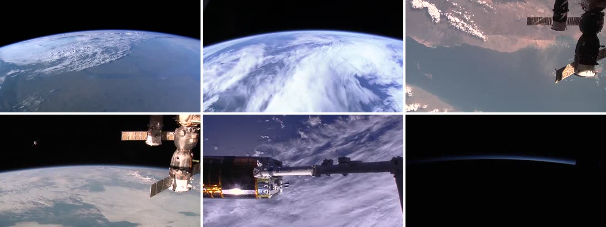
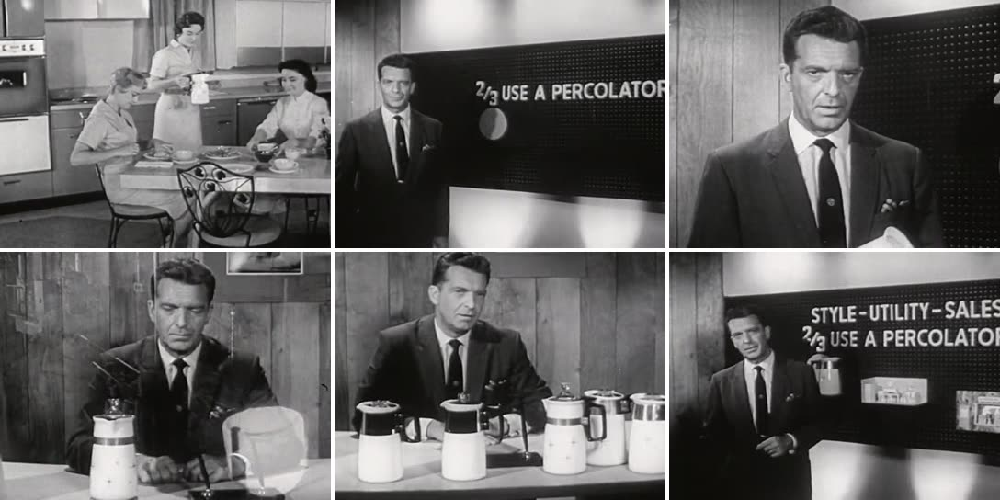

# footage-mcp

给 AI 做视频用的免费素材库：搜索视频、背景音乐和音效，先预览再下载，每条素材带授权信息，下载记录写进项目。另提供现成配音音色的查询和试听。

[English](#english)



`footage_inspect` 从真实视频里抽帧拼成一张图，AI 看完再决定用哪一段。

## 为什么要先看帧

AI 看不了视频，只看标题和简介挑素材，经常选错。下面这部片子在 Internet Archive 上搜「1950s factory assembly line」排第一，简介写着工厂和流水线，抽帧一看是咖啡壶广告：



## 快速开始

需要 Python 3.10+ 和 ffmpeg。

```sh
uvx --from git+https://github.com/bmdy6/footage-mcp footage-mcp search "earth from space" --limit 5
uvx --from git+https://github.com/bmdy6/footage-mcp footage-mcp inspect "nasa:Earth Views from the International Space Station"
uvx --from git+https://github.com/bmdy6/footage-mcp footage-mcp download archive:American1960 \
  --out-dir public/footage --start 120 --duration 5 --note "第 3 句：工厂"
```

<details><summary>Claude Code / Codex / Cursor · MCP 配置</summary>

**Claude Code**

```sh
claude mcp add footage -e PEXELS_API_KEY=xxx -e PIXABAY_API_KEY=xxx -- \
  uvx --from git+https://github.com/bmdy6/footage-mcp --with "mcp>=1.0,<3" footage-mcp mcp
```

**Codex · ~/.codex/config.toml**

```toml
[mcp_servers.footage]
command = "uvx"
args = ["--from", "git+https://github.com/bmdy6/footage-mcp", "--with", "mcp>=1.0,<3", "footage-mcp", "mcp"]
env = { PEXELS_API_KEY = "xxx", PIXABAY_API_KEY = "xxx" }
```

**Cursor · .cursor/mcp.json**

```json
{"mcpServers":{"footage":{"command":"uvx","args":["--from","git+https://github.com/bmdy6/footage-mcp","--with","mcp>=1.0,<3","footage-mcp","mcp"],"env":{"PEXELS_API_KEY":"xxx","PIXABAY_API_KEY":"xxx"}}}}
```

</details>

## 来源

| 来源 | 适合 | Key | 可商用 |
|---|---|---|---|
| `pexels` | 现代空镜、办公、城市、科技感 B-roll | 免费，[PEXELS_API_KEY](https://www.pexels.com/api/) | 依 Pexels 条款 |
| `pixabay` | 空镜、动态背景（不支持音乐 API） | 免费，[PIXABAY_API_KEY](https://pixabay.com/api/docs/) | 依 Pixabay 条款 |
| `commons` | Wikimedia Commons 视频、音频 | 不需要 | 按条目许可 |
| `archive` | Internet Archive 公有领域 / CC 视频、音频 | 不需要 | 按条目许可，含 NC |
| `europeana` | 欧洲电影档案；PDM、CC0、CC BY、CC BY-SA 的视频文件 | 默认公共 demo key；可设 [EUROPEANA_API_KEY](https://www.europeana.eu/en/apis) | 是，遵守署名 / SA |
| `nasa` | 太空、地球、科学影像和音频 | 不需要 | 通常可以，核对第三方内容 |
| `openverse` | CC 音乐、音效、语音聚合 | 匿名可用；可选 `OPENVERSE_CLIENT_ID` + `OPENVERSE_CLIENT_SECRET`，OAuth 提高限额 | 按条目许可，含 NC / ND |
| `freesound` | 音效，只取 HQ mp3 预览 | `FREESOUND_API_KEY` | CC0 / BY 可；BY-NC 不可，保留原许可 |
| `jamendo` | 背景音乐，遵守 `audiodownload_allowed` | `JAMENDO_CLIENT_ID` | 默认 false，商用另行购买 / 确认 |
| `edge-tts`（音色） | 在线配音音色目录及试听 | 不需要；可选 `[voice]` 依赖 | false，非官方接口，商用授权不明确 |

没配 key 的来源会跳过，结果里会写明 `skipped: set PEXELS_API_KEY`。

Europeana 没配 `EUROPEANA_API_KEY` 时使用公共 `api2demo`，配置后优先使用自己的 key。
公共 key 共享额度，稳定使用建议申请免费 key。搜索只收录开放许可且直接指向视频文件的记录，
不返回 YouTube、Vimeo 等播放器页面。`inspect` 和 `download` 会按 ID 重新读取当前许可；
文件级许可优先于记录级许可，缺失、含糊或受限的许可会拒绝。CC BY 需要署名，CC BY-SA 还要求改编作品使用相同许可。

## 找声音

`search` / `footage_search` 默认仍找视频。加 `--media audio`（MCP：`media="audio"`）找音乐或音效：

```sh
pip install 'footage-mcp[voice]'  # 本地开发可用 pip install -e '.[mcp,voice]'
footage-mcp search "upbeat ukulele" --media audio --limit 5
footage-mcp search "notification click" --media audio --sources openverse,freesound
# 把 AUDIO_ID 换成搜索返回的 id
footage-mcp inspect "AUDIO_ID" --out waveform.png
footage-mcp download "AUDIO_ID" --out-dir footage --start 5 --duration 10 --note "轻快背景音乐"
footage-mcp voices --lang zh-CN
footage-mcp voice-preview edge:zh-CN-XiaoxiaoNeural "你好，欢迎使用 StylePolish。" --out-dir footage
```

音频结果带 `media=audio`、秒数 `duration`、`kind`（music / sfx / speech / other）、`preview_url` 和与视频一致的 `license`。来源没给的字段会省略；Archive / NASA 的文件链接和时长可能要到 inspect 时才有。`commercial_ok` 对应 `license.commercial_use`；`--commercial-only` 只保留明确可商用的条目。Openverse 时长从毫秒转换为秒，授权与署名保留原始来源信息。[Openverse API](https://api.openverse.org/v1/)

音频 inspect 不抽帧，返回全段波形 PNG、时长和前 15 秒试听 mp3 路径。CLI 默认写 `waveform.png`；MCP 直接返回 PNG 图像和 JSON 路径。试听文件保存在系统临时目录，需要时自行清理。音频 download 输出裁剪后的 mp3，`note`、许可和署名写入同一个 `footage.json` / `CREDITS.md`；library 混合列出音频和视频，并为旧记录补 `media=video`。

Freesound 只用 token 可访问的 HQ mp3，不使用 OAuth2 原始文件下载。Jamendo 的试听与下载许可分开：禁止下载时仍可 inspect 试听，但 download 会拒绝；参加商业授权计划不代表已经购买授权。[Freesound API](https://freesound.org/docs/api/resources_apiv2.html) · [Jamendo tracks](https://developer.jamendo.com/v3.0/tracks)

MCP 新增 `voice_list(lang="zh-CN")`、`voice_preview(voice_id, text)`，音色目录带名字、性别、风格、来源和授权说明；没装 `[voice]` 时返回安装提示。[edge-tts](https://github.com/rany2/edge-tts) 使用微软在线现成音色：**非官方接口，商用授权不明确，适合演示/个人项目，`commercial_ok=false`**。不训练、不部署本地模型、不克隆声音。音色试听返回 mp3 路径和授权提醒，不自动加入素材 manifest。

## 工具

| 工具 | 做什么 |
|---|---|
| `footage_search` | 并发搜所有来源，结果交错排列；可按时长、横竖屏、能否商用过滤 |
| `footage_inspect` | 视频抽 1~12 帧；音频生成波形 PNG 和前 15 秒试听，返回时长与授权提醒 |
| `footage_download` | 按 `start` / `duration` 裁剪：视频 H.264 MP4（最宽 1920，默认静音），音频 mp3；长素材默认只取 30 秒 |
| `footage_library` | 列出这个项目已下载的素材，避免重复搜 |

## 素材就是上下文

每次下载都会写进 `out_dir/footage.json` 和 `CREDITS.md`。`footage.json` 记录每个文件是什么、用在脚本哪一句（`note`）、来自哪里、什么授权。下次让 AI 改视频，它先读这个文件就知道手上有什么。

```json
{
  "file": "archive-American1960-120s.mp4",
  "clip_id": "archive:American1960",
  "start": 120.0,
  "duration": 5.0,
  "note": "第3句：工厂流水线",
  "license": {"commercial_use": true, "attribution_required": false, "attribution": "Handy (Jam) Organization, via Internet Archive"}
}
```

`CREDITS.md` 可以直接贴到视频简介里。

## 搭配 Remotion

把 `out_dir` 设成 Remotion 项目的 `public/footage`，AI 写完脚本后按句搜素材、看帧、下载，再用 `<OffthreadVideo src={staticFile("footage/xxx.mp4")} />` 排进时间线。

## 授权说明

授权字段是按许可证名称和链接自动判断的，不构成法律意见。`commercial_use` 为 `null` 表示没认出来，发布前请打开 `page_url` 自己核对。仓库只放代码，不存、不转发任何素材文件；素材版权归原作者和平台。

## 开发

```sh
pip install -e ".[mcp,voice]" pytest build
pytest -q  # 离线测试；JSON 录制来源见 tests/fixtures/audio/README.md
python -m build
```

---

## English

Free footage for AI video agents. One search across Pexels, Pixabay, Wikimedia Commons, Internet Archive, Europeana and NASA. Every result carries license fields (`commercial_use`, `attribution_required`, `modifiable`). `footage_inspect` returns a contact sheet of real frames so the agent can see a clip before it uses it. `footage_download` trims to an H.264 MP4 and records the shot in `footage.json` and `CREDITS.md`, so the project keeps its own footage context.

Requires Python 3.10+ and ffmpeg. Pexels and Pixabay need free API keys (`PEXELS_API_KEY`, `PIXABAY_API_KEY`). Europeana uses the public demo key unless `EUROPEANA_API_KEY` is set; it only returns direct video files under PDM, CC0, CC BY or CC BY-SA and rechecks rights on resolve. CC BY requires attribution; CC BY-SA also requires sharing adaptations under the same license. Commons, Archive and NASA need no key. License detection is best effort, not legal advice. The repo contains code only and redistributes no media.

### Find audio

Video remains the default. Use `footage-mcp search "upbeat ukulele" --media audio --limit 5` or MCP `footage_search(query="upbeat ukulele", media="audio")`. Audio results carry `media`, duration in seconds, `kind` (music / sfx / speech / other), `preview_url`, the shared license fields and `commercial_ok`. Unavailable fields are omitted; Archive/NASA may fill file URLs and duration on inspect. `--commercial-only` retains only explicit `license.commercial_use=true`.

| Source | Audio / key | Commercial use |
|---|---|---|
| Commons | Audio + video, no key | Per-item license |
| Internet Archive | Audio + video, no key; PD/CC search filter retained | Per-item license; includes NC |
| NASA | Audio + video, no key | Generally allowed; check third-party content |
| Openverse | CC audio aggregator, anonymous; optional `OPENVERSE_CLIENT_ID` + `OPENVERSE_CLIENT_SECRET` for OAuth | Per-item license; includes NC/ND |
| Freesound | HQ mp3 previews only; `FREESOUND_API_KEY` | CC0/BY allowed; BY-NC disallowed; original license retained |
| Jamendo | Music; `JAMENDO_CLIENT_ID` | false by default; separate commercial clearance/purchase required |
| edge-tts voices | No key; install `footage-mcp[voice]` | false; unofficial interface, unclear commercial rights, demo/personal use |

Pexels, Pixabay and Europeana remain video-only here; Pixabay has no official music API. Missing required keys are skipped with a source-status message. Audio inspection returns a full waveform PNG, duration and a local first-15-seconds mp3; video inspection still returns JPEG frames. Audio downloads produce trimmed mp3 files, with license, attribution and `note` in the shared manifest and credits. `footage_library` lists both media types, including legacy videos. Preview files persist in the system temp directory until removed.

```sh
footage-mcp inspect "AUDIO_ID" --out waveform.png
footage-mcp download "AUDIO_ID" --out-dir footage --start 5 --duration 10 --note "music bed"
pip install 'footage-mcp[voice]'
footage-mcp voices --lang zh-CN
footage-mcp voice-preview edge:zh-CN-XiaoxiaoNeural "你好，欢迎使用 StylePolish。" --out-dir footage
```

Replace `AUDIO_ID` with a returned ID. MCP also exposes `voice_list(lang="zh-CN")` and `voice_preview(voice_id, text)`. Missing voice dependencies return an install hint. Voice previews return an mp3 path and license notice; they are not added to the footage manifest. There is no local voice model, cloning or Freesound OAuth2. Jamendo download permission is checked independently from streaming; Pro-program membership does not establish purchased rights. See the [Openverse API](https://api.openverse.org/v1/), [Freesound API](https://freesound.org/docs/api/resources_apiv2.html), [Jamendo API](https://developer.jamendo.com/v3.0/tracks) and [edge-tts](https://github.com/rany2/edge-tts).

MIT License.
