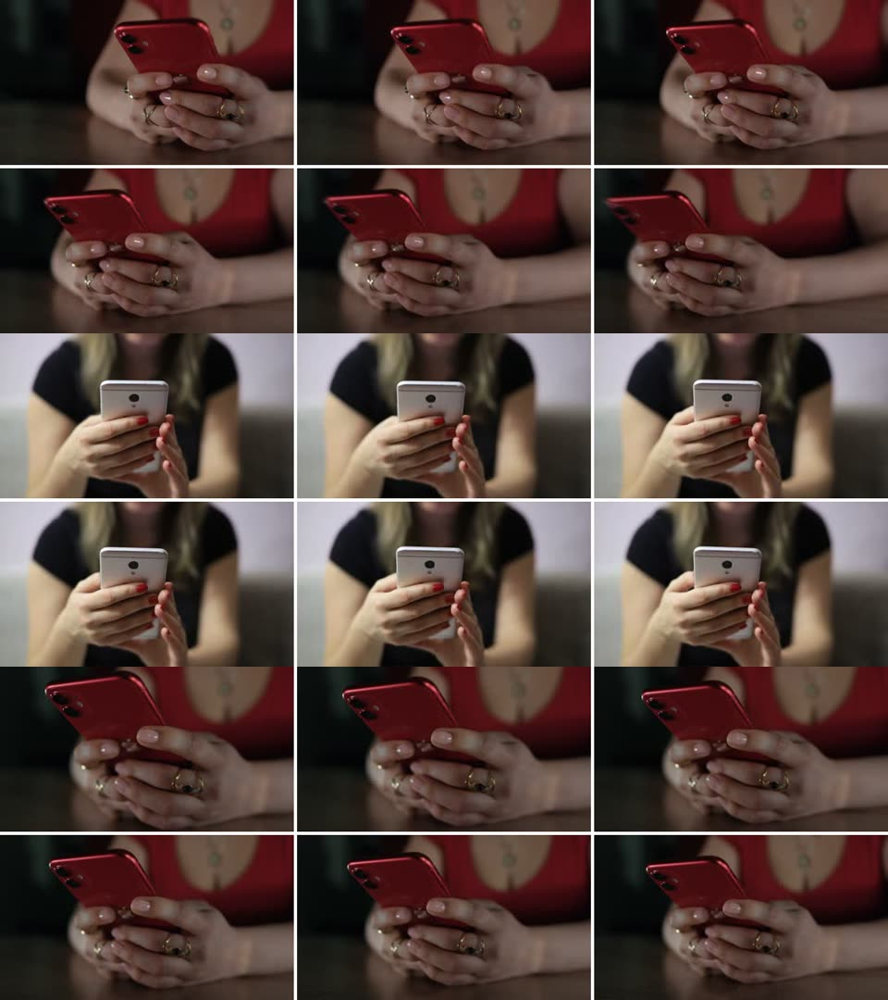

# Issue #4 live acceptance — 2026-11-12

Ran the real CLI against online sources, using the exact four-line narration from [Issue #4](https://github.com/bmdy6/footage-mcp/issues/4) and the [StylePolish promo](https://github.com/bmdy6/stylepolish#readme) scenario. No mocked source responses were used for these results. Full downloaded media stays outside the repository in `/tmp/footage-issue4/footage`; only comparison previews, metadata and reports are included here.

## Script planning

```sh
footage-mcp plan docs/examples/stylepolish-script.txt \
  --queries docs/examples/stylepolish-queries.json \
  --sources pixabay,commons --commercial-only --out-dir /tmp/footage-issue4/final-plan
```

Only `PIXABAY_API_KEY` was available in `~/.config/ai-vault/vault.json`. It was passed in the process environment, never written to artifacts. No Pexels, Europeana, Freesound, Jamendo or Openverse OAuth credentials were available; this run explicitly selected Pixabay and Commons. Openverse ran anonymously below. The first attempt failed TLS verification because system Python 3.13 had no default CA file; rerunning with `SSL_CERT_FILE=/etc/ssl/cert.pem` succeeded. Certificate verification stayed enabled; no machine configuration was changed.

| Nonempty script line | Query | Pixabay / Commons matches | Selected candidate IDs in comparison order | Comparison |
|---|---|---|---|---|
| 1 | typing smartphone message | 12 / 12 | `pixabay:204527`, `pixabay:38084`, `pixabay:204526` | [Image 1](plan-stylepolish-line-1.jpg) |
| 2 | working laptop typing | 12 / 3 | `pixabay:203260`, `pixabay:61037`, `pixabay:10822` | [Image 2](plan-stylepolish-line-2.jpg) |
| 3 | editing text keyboard | 12 / 12 | `pixabay:3174`, `pixabay:232538`, `pixabay:10822` | [Image 3](plan-stylepolish-line-3.jpg) |
| 4 | sending message phone | 12 / 12 | `pixabay:47743`, `pixabay:64289`, `pixabay:168343` | [Image 4](plan-stylepolish-line-4.jpg) |

The final-version rerun refreshed line 2's candidate order; this table and the images reflect that rerun. All four lines have **3 distinct IDs, 3 successful six-frame inspections and one vertical comparison JPEG** (960×1080). Each candidate is one six-frame block (two image rows); `comparison_row` counts candidate blocks. All selected candidates happened to be Pixabay after ranking; both providers returned real candidates. See [plan summary with authors, license fields, frame timestamps and source pages](acceptance/issue-4/plan-summary.json). This records metadata rather than expiring direct asset URLs or machine-specific preview paths.

Visual review: line 1 shows people holding/typing on smartphones; lines 2–3 show laptop/keyboard typing (line 2's second candidate is an animation); line 4 shows messaging/phone use and an illustration. These are contextual B-roll, **not footage of StylePolish's actual correction UI**. Different IDs can show similar shots. No claim is made that this automatically selects the final promotional shots, or that the heuristic trim estimates fill an exact 30-second timeline.



## Apply two sentences and export credits

```json
{"1":"pixabay:204527","2":"pixabay:10822"}
```

```sh
footage-mcp plan-apply /tmp/footage-issue4/final-plan/plan.json \
  --choices /tmp/footage-issue4/choices.json --out-dir /tmp/footage-issue4/footage
footage-mcp voices --lang zh-CN
footage-mcp voice-preview edge:zh-CN-XiaoyiNeural '消息打完，总怕有错别字？' \
  --out-dir /tmp/footage-issue4/voice
footage-mcp credits --out-dir /tmp/footage-issue4/footage
```

- Apply downloaded **2 videos, 0 errors**. ffprobe confirmed durations **2.000 s** and **2.800 s**; each manifest `note` exactly matches its sentence. Names are line-specific to avoid collisions.
- Live Edge catalog returned **6 zh-CN voices**. A real Xiaoyi preview succeeded, **3.240 s**. Before credits, this preview file and the voice API's original license metadata were explicitly registered in the test manifest. This is a test-fixture preparation step, not a new automatic voice-to-manifest feature; existing voice-preview behavior is unchanged.
- Credits reads **3 manifest entries**, writes Chinese/English attribution, and flags `edge:zh-CN-XiaoyiNeural` with **commercial_replace, unknown_license, missing_attribution**. Its original notice remains “非官方接口，商用授权不明确，适合演示/个人项目”. The voice is not cleared for commercial publication.
- Evidence: [manifest](acceptance/issue-4/footage.json), [generated bilingual CREDITS.md](acceptance/issue-4/CREDITS.md), [LICENSE-RISKS.json](acceptance/issue-4/LICENSE-RISKS.json). Absolute report paths were normalized to relative paths in the evidence copy only.

## Openverse audio marks

```sh
footage-mcp search 'upbeat ukulele' --media audio --sources openverse --limit 5
footage-mcp audio-marks openverse:4efa09ec-60bd-4ac6-af23-c09481f3b570 --beats
```

Analyzed the real full-length **Upbeat Ukulele**, [Jamendo track 970482](https://www.jamendo.com/track/970482), returned by Openverse with **CC BY-NC-ND 3.0**. This audio was analyzed, not trimmed or included in the downloaded project manifest. Beat decoding uses a temporary WAV that is cleaned up.

| Measurement | Actual output |
|---|---|
| Duration | 175.000 s |
| Silence (`-35 dB`, minimum `0.3 s`) | 171.596009–175.000 s (3.404 s) |
| Integrated loudness | -11.3 LUFS |
| Loudness range | 3.8 LU |
| True peak | +1.0 dBFS |
| Suggested in / out | 0 / 171.596 s |
| Optional librosa beats | status=ok; 213 points; 80.7495 BPM estimate |

See [full analysis JSON](acceptance/issue-4/openverse-marks.json). A suggested point is a measurement reference, not permission to trim an ND recording. No claim is made about beat accuracy against a human annotation.

## Automated and protocol checks

- Base-only isolated Python 3.14 environment: `pytest -q` → **72 passed, 3 skipped**; confirms `mcp`, `edge_tts` and `librosa` are absent. Optional-adapter tests skip; all core tests run.
- Full isolated environment with `[mcp,voice,beats]`: `pytest -q` → **75 passed, 0 skipped**; all tests run. Includes real local ffmpeg silence/tone tests, real vertical image composition, source mocks only in offline tests, invalid choices before downloads, partial-failure persistence, duplicate-file protection, changed-commercial-rights exclusion before publication, license risks and missing-extra behavior.
- Live stdio MCP `initialize` → `tools/list` exposed all 10 tools, including the four additions. A real `tools/call` to `footage_plan` for Chinese text without queries returned `needs_queries=true`.
- Built wheel and sdist with `python -m build`. Installed the wheel alone (no extras) in a fresh environment and ran plan/credits from `/tmp`, verifying imports came from site-packages rather than the checkout. Also ran audio-marks on the real local Xiaoyi preview in the base environment: measurements succeed and requested beats returns the missing-extra install hint.

No editing/rendering, LLM query generation, default-tool changes, full media commits, deployment or merge. Providers without keys were not live-tested; the acceptance path above completed with the available key and anonymous services.
